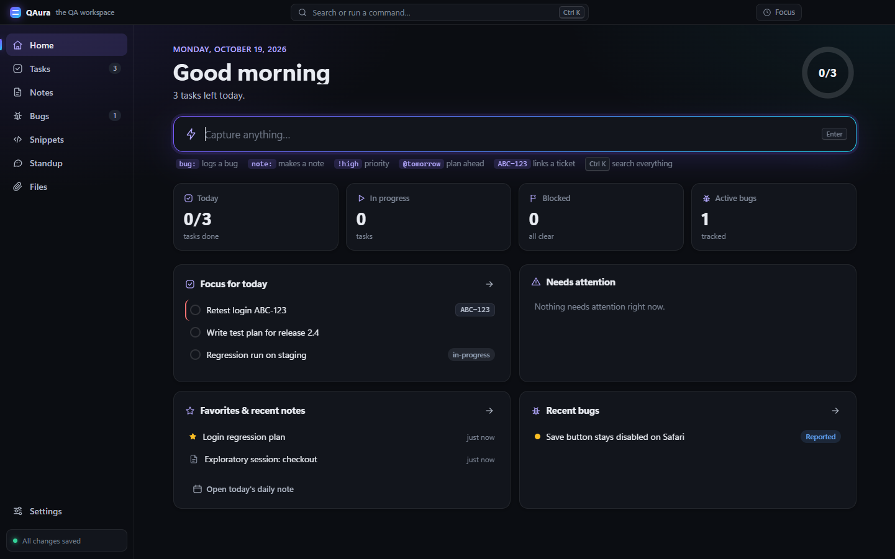
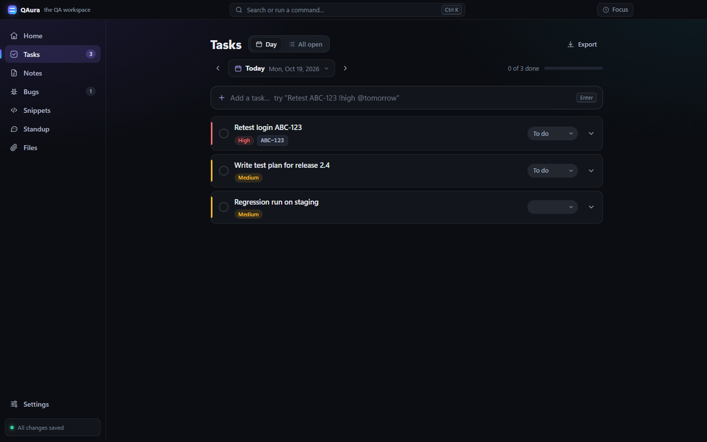
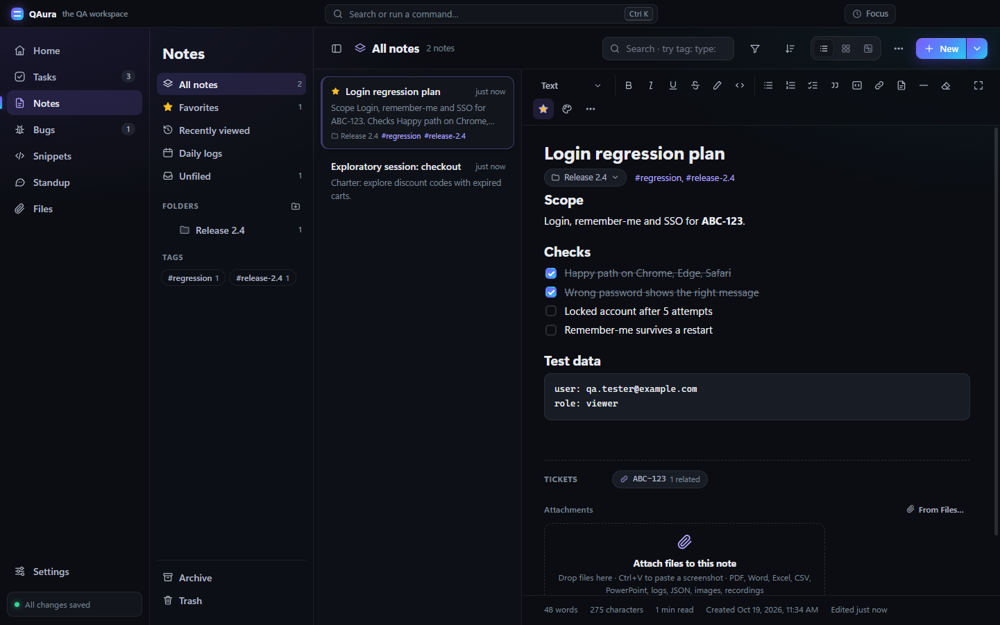
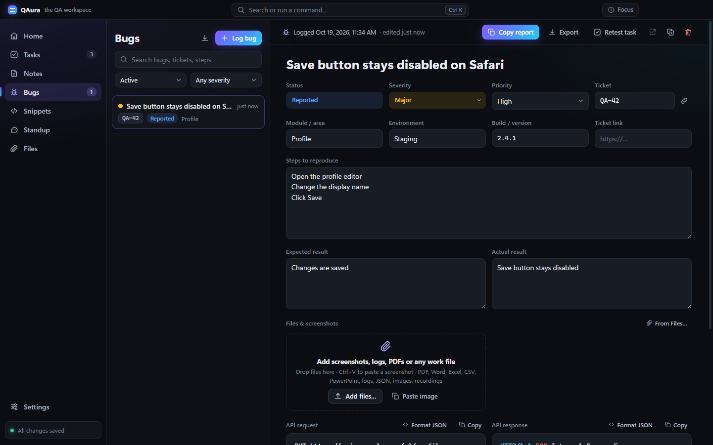
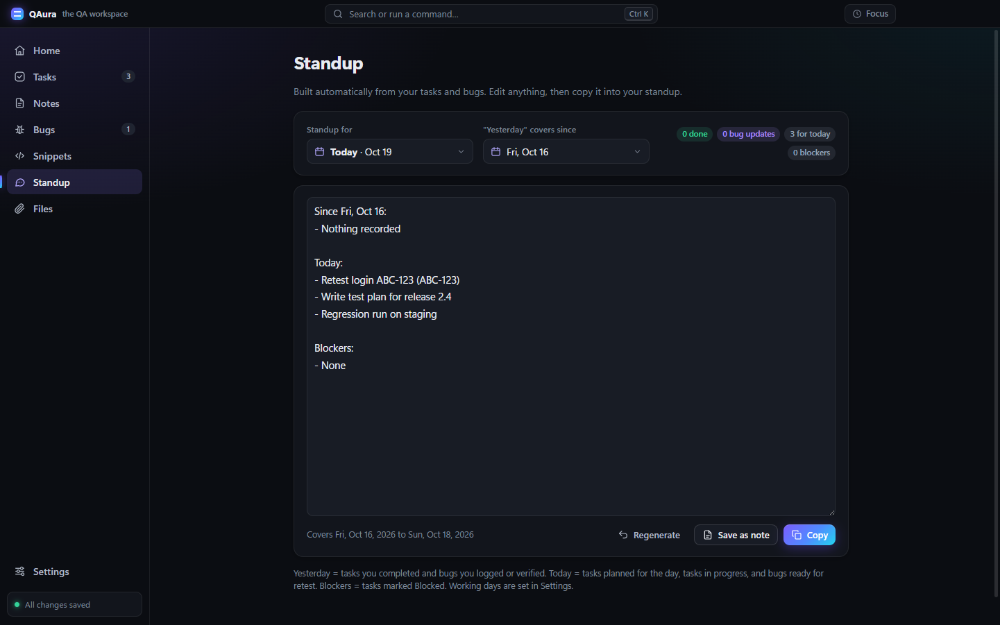
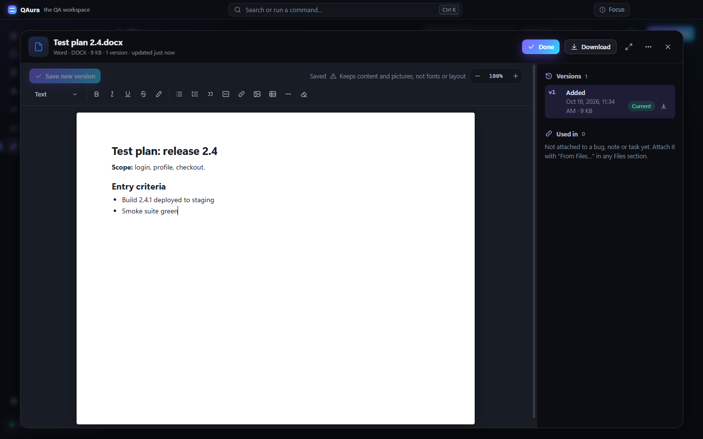
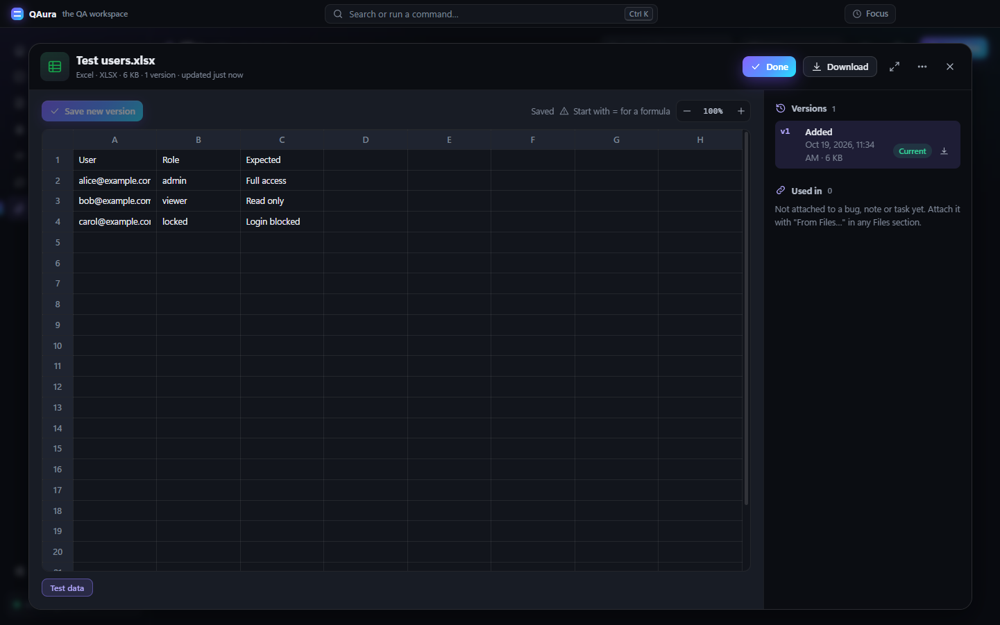
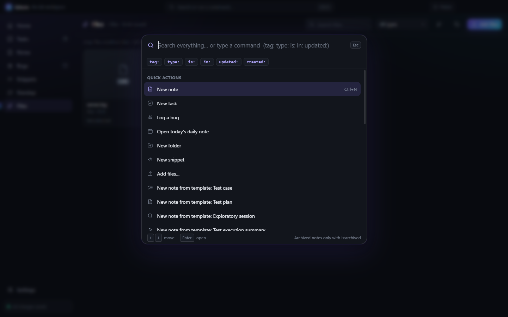

# QAura — the QA workspace

**An offline desktop notepad built for QA and software testers.** Plan your day, keep rich-text test notes, log bugs with API calls and screenshots, reuse SQL/curl snippets, generate your standup, and keep every work file (PDF, Word, Excel, logs, recordings) in one place, with every version kept.

Everything stays on your computer. QAura makes **no network requests**, and your data is saved within half a second, backed up automatically and never overwritten.



---

## Contents

- [Features](#features)
- [Your data is safe](#your-data-is-safe)
- [Offline and private](#offline-and-private)
- [Getting started](#getting-started)
- [Keyboard shortcuts](#keyboard-shortcuts)
- [Development](#development)
- [Project structure](#project-structure)
- [Known limitations](#known-limitations)
- [License](#license)

---

## Features

### Home
- **Capture bar:** type `bug: Login fails on Safari !high` or `Retest ABC-123 @tomorrow` and QAura creates the bug or task, priority and date included.
- Today's focus, things that need attention, favourite and recent notes, recent bugs.

### Tasks
- Day planner with **Today / All open** views, priorities, planned and due dates (custom calendar), ticket IDs and **blockers**.
- Unfinished tasks carry over; progress for the day at a glance.
- **Export to Excel or CSV.**



### Notes
- **Rich-text editor** with Markdown-style shortcuts (`# ` heading, `- ` list, `[] ` checklist, ```` ``` ```` code block, `> ` quote), tables, links and highlights.
- **Nested folders**, tags, favourites, archive, Trash, daily logs and QA **templates** (test case, test plan, exploratory session, execution summary).
- `[[` links between notes with backlinks, and a **ticket hub** that gathers every note, task and bug that mentions a ticket like `ABC-123`.
- **List, Grid and Board** (sticky notes) views; sort and filter by colour, type, date and open to-dos.
- Search operators: `tag:` `type:` `is:favorite` `is:open` `is:archived` `in:"Folder"` `updated:last-7-days`.
- Export a note or a whole folder to **Word, PDF, Markdown, text or HTML**; import `.md` / `.txt` files.



### Bugs
- Structured bug log: status, severity, priority, module, environment, build, ticket link, steps, expected and actual results.
- **API request / response** fields with JSON formatting and syntax highlighting.
- **Screenshots and files:** paste with `Ctrl+V` (e.g. after `Win+Shift+S`), drop or pick files; copy an image straight into Jira.
- **Copy report** (ready for Jira / Teams), status history, retest task, duplicate.
- Export one bug as a **Word or PDF report** (screenshots embedded), or the list to **Excel / CSV**.



### Snippets
- Reusable SQL, curl / API calls, JSON payloads and scripts with syntax highlighting.
- `{{placeholders}}` ask for values when you copy.

### Standup
- Built automatically from your tasks and bugs (yesterday, today, blockers), respecting your working days. Edit, copy, or save as a note.



### Files
- One library for **PDF, Word (.docx), Excel (.xlsx), CSV, PowerPoint (.pptx), TXT, LOG, JSON, XML, HAR, YAML, SQL, Markdown, images and MP4 / WebM recordings.** Attach any file to bugs, notes and tasks.
- Opens in a large viewer with **zoom** and a **fill-the-window** mode; PDFs open in a built-in viewer window.
- **Edit right inside QAura:**
  - **Word:** the page becomes an editor (headings, lists, tables, links, pictures); saving writes a real `.docx`.
  - **Excel:** edit cells, numbers and `=formulas`; only the changed cells are written, so formatting, formulas, merged cells and other sheets are kept.
  - **CSV:** a spreadsheet-style grid. **Text, logs, JSON:** a code editor with *Format JSON*.
- **Every save is a new version.** The original is never changed; restore or download any version.
- Or open the file in Word / Excel / PowerPoint (or LibreOffice) directly: each save there comes back to QAura as a new version.
- **File Explorer integration:** right-click a file → *Open with* → **QAura** stores a copy and opens it (the original file is never changed).

| Word editing | Excel editing |
|---|---|
|  |  |

### Everywhere
- **Command palette and global search** (`Ctrl+K`) across notes, tasks, bugs, snippets, folders and files.
- Dark, light or match-Windows theme; focus timer; distraction-free mode.



---

## Your data is safe

Never losing data is QAura's first rule.

- **One local data file**, `%APPDATA%\QAura\data.json`, written atomically (temp file → flush to disk → rename), so a crash or power cut never leaves it half-written. The previous version is kept as `data.prev.json`.
- Saves **within half a second** of a change (at most 2 seconds while typing), and again when you close the app.
- **Automatic backups** in `%APPDATA%\QAura\backups`: on launch, every 30 minutes while you work and once a day (the last 90 days are kept). *Back up now* and restore are in Settings; restoring first saves a copy of the current data.
- **Optional second copy** (e.g. a OneDrive or network folder): Settings → Data safety → *Choose folder*.
- **Recovery:** if the data file is ever unreadable, QAura restores the newest intact copy and keeps the damaged file aside. If nothing usable is found it opens **read-only** instead of starting empty.
- **Files are append-only:** stored once under their SHA-256 hash and never modified or deleted; edits become new versions.
- Deleted items go to **Trash** and can be restored. Installing or updating the app never touches the data folder.

## Offline and private

- **No network requests at all.** Every library is bundled, and the app window is locked down by a Content Security Policy (`connect-src 'none'`). The automated tests fail if any request leaves the computer.
- No accounts, no analytics, no updates phoning home.
- Office files are only ever opened in the installed Office app (or LibreOffice), or in an app *you* pick. QAura never hands a file to whatever Windows has set as the default, which might be an online service.

---

## Getting started

**Requirements:** Windows 10 or 11, [Node.js](https://nodejs.org/) (tested with Node.js 24) and Git.

```bash
git clone https://github.com/yashmaske05/qaura.git
cd qaura
npm install      # also copies the browser libraries into src/vendor
npm start        # run QAura from source
```

### Build and install

```bash
npm run package      # builds dist\QAura-win32-x64\QAura.exe
npm run install-app  # installs for the current user (close QAura first)
```

`install-app` copies the app to `%LOCALAPPDATA%\Programs\QAura` and adds Desktop and Start Menu shortcuts. It also adds **QAura to File Explorer's *Open with* menu** for the supported file types; your default apps are not changed. To take QAura out of *Open with* again:

```powershell
powershell -ExecutionPolicy Bypass -File scripts\open-with.ps1 -Remove
```

---

## Keyboard shortcuts

| Keys | Action |
|---|---|
| `Ctrl+K` | Search everything / run a command |
| `Ctrl+1` … `Ctrl+7` | Home, Tasks, Notes, Bugs, Snippets, Standup, Files |
| `Ctrl+N` | New item in the current section |
| `Ctrl+F` | Search in Notes / Bugs / Snippets |
| `Ctrl+S` | Save now (it also saves automatically) |
| `Ctrl+,` | Settings |
| `Ctrl+B` / `I` / `U` | Bold / italic / underline |
| `Ctrl+Shift+H` / `Ctrl+E` | Highlight / inline code |
| `Ctrl+K` (in a note) | Add a link |
| `[[` | Link to another note |
| `Ctrl+Shift+F` | Distraction-free mode |

---

## Development

```bash
npm test
```

Runs the end-to-end suite (`test/smoke.js`, 160+ checks) with Playwright against the real Electron app. Each run uses throwaway data folders, renders offscreen and uses its own in-memory clipboard, so it never touches your QAura data, your screen or your clipboard. It covers saving and recovery, backups, every section, files and versions, Word / Excel / PDF exports (read back with real Word and Excel readers), *Open with*, and the no-network rule.

`npm run package` also hardens the built executable (Electron fuses: `RunAsNode` and `NODE_OPTIONS` turned off).

**Tech stack:** Electron 44 with plain JavaScript (no framework), sandboxed renderer with context isolation. Libraries: DOMPurify (sanitizing), marked (Markdown import), highlight.js (code), mammoth (reading .docx), docx (writing .docx), ExcelJS (.xlsx), Playwright (tests).

## Project structure

```
main.js              Electron main process: storage, backups, recovery, file store, Open with, exports
preload.js           The safe bridge between the app window and the main process
src/index.html       App window (strict Content Security Policy)
src/styles.css       All styles, dark and light themes
src/js/
  store.js           Data model, saving, migrations
  editor.js          Rich-text engine (notes and Word documents)
  files.js           Files: viewer, versions, Word / Excel / CSV / text editing
  office.js          Word, PDF, Excel and CSV exports
  html.js            Sanitizing and HTML / Markdown / text conversion
  ui.js, util.js     Dialogs, menus, viewer, calendar, toasts, icons and helpers
  search.js, palette.js, tickets.js, templates.js, capture.js, export.js, focus.js, app.js
  views/             Home, Tasks, Notes, Bugs, Snippets, Standup, Files, Settings
scripts/             Build, packaging, install, Open with registration, vendoring, icon
test/                End-to-end tests and fixtures
docs/screenshots/    Images used in this README
```

## Known limitations

- **Windows only** (the only platform built and tested).
- **Word editing in QAura** keeps the content (text, headings, lists, tables, links, pictures) but not fonts, colours, page layout, headers / footers or comments. You're told before editing, and the original version is always kept. Use *Open in Word* for full fidelity.
- **Excel editing in QAura** keeps values, formulas, formatting and sheets, but **charts and pivot tables are not kept** in the edited version (QAura warns first; the original keeps them). Some workbooks made by tools other than Excel can't be read.
- PowerPoint files have no preview (open them in PowerPoint).

## License

No license has been chosen yet, so all rights are reserved by the author. Third-party libraries keep their own licenses (listed in `src/vendor/THIRD-PARTY-LICENSES.txt` after `npm install`).
